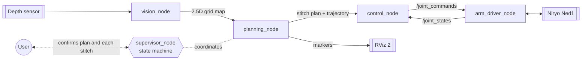

# SUTURA

**Suture Robotisée Autonome à faible coût**: a low-cost autonomous suturing system built on
ROS 2, with a 6-DOF Niryo Ned1 arm and a depth sensor. ENSTA Bretagne team project.

> **Status: work in progress.** The data models, the suture-pattern generator and the Ned1 arm
> driver are implemented and tested. Perception, trajectory planning, control and the supervisor
> are designed but not yet written. This is a student research prototype, not a medical device.

## How it works

The system maps the wound surface, plans where each stitch goes, turns the plan into arm
motions, and asks the user to confirm the plan and every stitch before it is executed.



## Status

| Part | State |
|---|---|
| Data models (`Point3D`, `Pose3D`, `StitchTarget`, `GridMap2D`) | Implemented, tested |
| Suture pattern: linear | Implemented, tested |
| `planning_node` | Runs on a simulated wound and publishes the plan to RViz 2 |
| Ned1 arm driver (`arm_driver_node`) | Implemented, tested against a simulated robot |
| `vision_node`, trajectory planner, `control_node`, `supervisor_node` | Planned |

## What is implemented

**Wound map.** `GridMap2D` is a 2.5D grid of the tissue surface (elevation, wound mask and
confidence layers, in millimetres). Surface normals are estimated from the elevation layer by
central differences.

**Suture pattern.** `LinearPatternGenerator` finds the wound's main axis by 2D PCA on the wound
cells, places stitches at a fixed spacing along it (with a margin at both ends), and puts the
needle entry and exit points on either side of the centreline, perpendicular to the wound and
to the local surface normal. Each stitch carries an entry and an exit pose oriented along the
normal.

**Arm driver.** The driver layer is behind a common `BaseArmDriver` interface, so the arm can be
swapped without touching the other nodes (Ned1, mock, and the earlier MAKIINA arm). The Ned1
driver talks to the arm through pyniryo 1.0.5 and is built for safety on real hardware:

- commands outside the joint limits (with a safety margin), larger than a maximum step, of the
  wrong size, or containing NaN/inf are rejected, never clipped;
- speed is capped (20 % by default);
- blocking moves run in a separate thread so the ROS executor stays responsive;
- emergency-stop, reset and home services;
- a lost connection is detected, the node publishes `DISCONNECTED` and stops publishing stale
  joint states.

**Tests.** 41 unit tests (pytest): data models, pattern generation, and the Ned1 driver against
a simulated robot and against the real pyniryo client talking to a fake TCP server. The driver
tests run without ROS.

## Hardware

- **Arm:** Niryo Ned1 (software 3.1.1), controlled with pyniryo 1.0.5.
- **Sensor:** iSense depth sensor planned; an extra camera is under evaluation.

## Quick start

Requires ROS 2 Jazzy (Ubuntu 24.04). Full setup, including Windows and the network link to the
arm, is in [`docs/SETUP.md`](docs/SETUP.md).

```bash
mkdir -p ~/sutura_ws/src && cd ~/sutura_ws/src
git clone https://github.com/henrique-kado/SUTURA.git
cd ~/sutura_ws
rosdep install --from-paths src --ignore-src -y
colcon build --symlink-install && source install/setup.bash

# Suture plan on a simulated wound, shown in RViz 2
ros2 run sutura planning_node --ros-args --params-file src/SUTURA/src/sutura/config/sutura_params.yaml
rviz2   # Fixed Frame: camera_frame; add a MarkerArray on /sutura/visualization/pattern

# Arm driver with the simulated arm (set arm.type to "ned1" for the real one)
ros2 run sutura arm_driver_node --ros-args --params-file src/SUTURA/src/sutura/config/sutura_params.yaml

# Tests
colcon test --packages-select sutura && colcon test-result --verbose
```

Before moving the real arm, read [`docs/drivers/ned1.md`](docs/drivers/ned1.md): the Ned1 has no
software stop for a move in progress, so keep the power switch within reach.

## Repository layout

```
src/sutura/
  config/sutura_params.yaml   parameters (pattern, planner, arm)
  sutura/
    utils/data_models/        Point3D, Orientation3D, Pose3D, StitchTarget, GridMap2D
    planning/patterns/        suture pattern generators
    planning/planners/        trajectory planners (planned)
    drivers/                  BaseArmDriver, Ned1 / mock / MAKIINA drivers, arm_driver_node
    vision/ control/ supervisor/   (planned)
  test/                       pytest suites
docs/                         setup guide and Ned1 driver notes
ARCHITECTURE.md               detailed architecture
```

The detailed documents ([`ARCHITECTURE.md`](ARCHITECTURE.md), [`docs/`](docs)) are written in
Portuguese; the code is in English.

## Team

ENSTA Bretagne team project (3 students), 2026.

## License

MIT, see [`LICENSE`](LICENSE).
